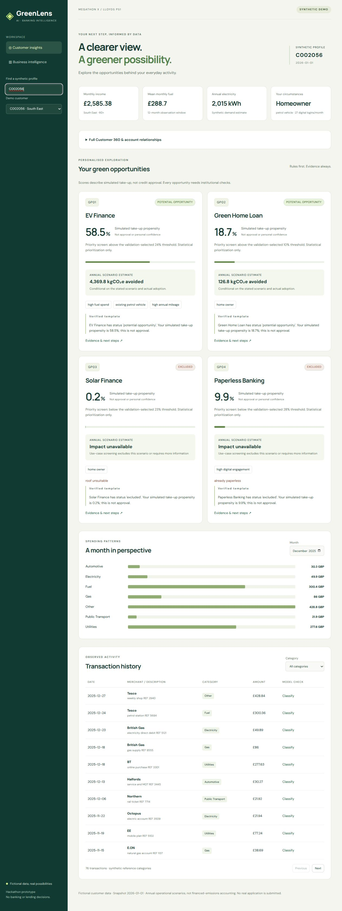
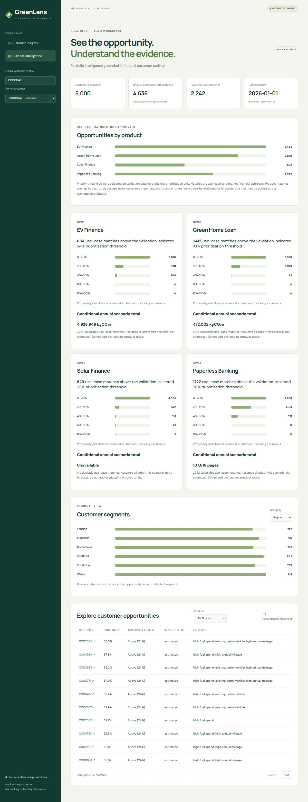
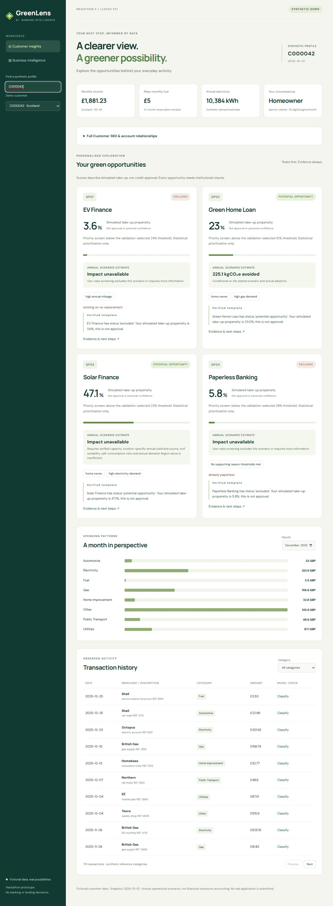
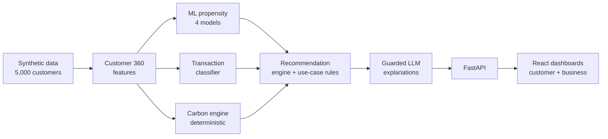

<div align="center">

# 🌿 GreenLens AI

**Explainable green-banking insights, where machine learning predicts, rules decide, a carbon engine calculates, and an LLM only explains.**

[](LICENSE)


Built by **Team 43** (Ram Kumar, Sai Jaswanth, Koushik, Abhinav Tej, Karthikeya) for **Megathon X: Singularity**, Problem Statement 1 (Lloyds): *Green Customer Insights Platform*.

</div>

---

## Overview

Banks can see how customers spend, but it is hard to turn that into relevant, trustworthy green-product suggestions. The bigger risk is **greenwashing**: carbon claims that can't be traced or defended.

GreenLens AI analyses customer transactions and profiles to find opportunities for four green products, estimates the sustainability impact with documented formulas, and explains every recommendation with evidence, reason codes and a timestamp.

| Code | Product | Typical signals |
|---|---|---|
| **GP01** | EV Finance | High recurring fuel spend, petrol vehicle, high mileage |
| **GP02** | Green Home Loan | Home ownership, gas and utility usage |
| **GP03** | Solar Finance | Home owner, high electricity use, suitable roof |
| **GP04** | Paperless Banking | Paper statements, high digital activity |

> **Everything is fictional.** All customers, transactions and take-up labels are synthetic. No real banking data is used anywhere in this repository.

## Screenshots

| Customer view | Business view |
|---|---|
|  |  |



## The core idea: a strict division of roles

The system never lets one component do another's job.



| Component | Does | Never does |
|---|---|---|
| **ML models** | Estimate simulated take-up propensity | Decide eligibility or calculate carbon |
| **Use-case rules** | Exclude or hold products (e.g. existing EV owner) | Predict behaviour |
| **Carbon engine** | Compute annual kgCO₂e scenarios from documented factors | Predict behaviour or decide eligibility |
| **LLM layer** | Choose approved wording to explain structured results | Predict, calculate, or approve anything |

**Propensity is not eligibility.** A high score never overrides a rule, and use-case screening is not credit approval.

## Features

- **Customer 360** view combining spending, products, vehicles, energy and digital behaviour.
- **Transaction categorisation** into 8 mutually exclusive categories (Fuel, Electricity, Gas, Public Transport, Home Improvement, Automotive, Utilities, Other).
- **Opportunity detection** per customer and product: propensity, reason codes, evidence, reliability tier and data timestamp.
- **Sustainability impact** from a deterministic engine using 2025 UK DESNZ conversion factors. Missing inputs return `UNAVAILABLE` instead of a guess.
- **Exclusions are visible.** Products the data rules out appear in a separate *Not recommended or more information needed* section and are never recommended.
- **Scenario explorer.** Toggle EV, Green home, Solar and Paperless chips, alone or combined, to compare the original profile with one merged hypothetical profile. Saved models, rules and the carbon engine rerun on a copy. Nothing is saved.
- **Guarded LLM explanations** with a deterministic offline fallback.
- **Business dashboard** with opportunities by product, segments, regional view, monthly spending trends, energy totals, paperless adoption and drill-down: Customer → Opportunity → Evidence → Impact → Action.

## Results

All results are on **synthetic labels**, so they show the pipeline works and is validated on held-out customers. They are **not real-world accuracy**.

**Propensity models** (held-out test set; customer-level splits, no overlap)

| Product | Test AUC | Fixed rule baseline F1 |
|---|---|---|
| GP01 EV Finance | 0.751 | 0.305 |
| GP02 Green Home | 0.815 | 0.312 |
| GP03 Solar | 0.901 | 0.339 |
| GP04 Paperless | 0.866 | 0.512 |

All four beat the constant-prevalence baseline. The rule baselines were fixed in advance and not tuned on the held-out set. Full metrics (Brier, calibration, thresholds) are in [`docs/model_evaluation.md`](docs/model_evaluation.md).

**Transaction classifier**

| Evaluation | TF-IDF classifier (macro F1) | Rule baseline (macro F1) |
|---|---|---|
| Customer-held-out test split | **0.980** | 0.918 |
| Merchant-held-out diagnostic | 0.095 | **0.921** |

The second row is a deliberate honesty check: the classifier learned merchant names and does **not** generalise to unseen merchants. The rule baseline does. See the limitations below.

**Reproducibility:** pinned requirements, a read-only audit (`python -m ml.run_pipeline`) that reloads the saved models and reproduces recorded metrics, 51 Python tests and 6 frontend tests.

## Data and labels

| Item | Value |
|---|---|
| Customers | 5,000 synthetic UK customers |
| Transactions | about 368,000 |
| Splits | 3,500 train / 750 validation / 750 test, **by customer ID, zero overlap** |
| Observation period | 1 Jan 2025 to 31 Dec 2025 |
| **Cutoff date** | **1 Jan 2026** (features use only data before this) |
| **Take-up outcome window** | 1 Jan to 30 Jun 2026 (simulated adoption) |

Labels come from a documented generator with plausible relationships to the features, not arbitrary assignment. Numeric imputation uses training medians only. See [`docs/synthetic_methodology.md`](docs/synthetic_methodology.md) and [`docs/data_dictionary.md`](docs/data_dictionary.md).

## Sustainability method

Impact values are **conditional annual operating scenarios, not promised savings** and not financed-emissions accounting. They use 2025 UK DESNZ conversion factors stored in [`data/reference/emission_factors_2025.json`](data/reference/emission_factors_2025.json).

| Product | Scenario | Status |
|---|---|---|
| GP01 EV | Current petrol/diesel transport emissions vs EV grid charging | Estimated |
| GP02 Green Home | Documented 10% gas-demand efficiency scenario | Estimated |
| GP03 Solar | 4 kWp London reference system (919 kWh/kWp/yr) with a sourced self-consumption assumption | London only; otherwise `UNAVAILABLE` |
| GP04 Paperless | Pages avoided | CO₂ `UNAVAILABLE` (no verified lifecycle factor) |

GHG Protocol and PCAF are cited as reference frameworks. The scenarios are **not** formally conformant project accounting or financed-emissions reporting. Impacts across products are separate and must not be added. Details: [`docs/sustainability_methodology.md`](docs/sustainability_methodology.md).

## Explainability and Responsible AI

- Every recommendation shows **reason codes, evidence, reliability tier, status and data timestamp**.
- The LLM is a **constrained sentence selector**. It chooses only from pre-approved templates, validates against the structured data, and falls back to deterministic text if anything fails.
- Offline guardrail evaluation: **28/28** cases pass (groundedness, factual accuracy, completeness, numerical consistency), plus **4/4** missing or conflicting input checks. No live provider output has been verified.
- Customer-facing text is labelled as synthetic, estimated and not an approval.

Privacy, bias, hallucination controls, human oversight and data limits are covered in [`docs/responsible_ai.md`](docs/responsible_ai.md).

## Quick start

**Requirements:** Python 3.12, Node.js 18+ (for the frontend). Python 3.12 matters: the saved models were built with scikit-learn 1.9.1.

```bash
git clone https://github.com/<your-username>/greenlens-ai.git
cd greenlens-ai

# Backend environment
uv venv --python 3.12            # or: python3.12 -m venv .venv
source .venv/bin/activate        # Windows PowerShell: .venv\Scripts\Activate.ps1
uv pip install -r requirements-api.txt   # or: pip install -r requirements-api.txt
```

Optional checks (read-only, no training):

```bash
python -m ml.run_pipeline        # reloads saved models, verifies splits and metrics
python -m pytest -q
```

**Start the API**

```bash
LLM_ENABLED=false python -m uvicorn backend.app:app --reload
# PowerShell: $env:LLM_ENABLED="false"; python -m uvicorn backend.app:app --reload
```

Wait for `Application startup complete`. API docs: <http://localhost:8000/docs>

**Start the UI** (second terminal)

```bash
cd frontend
npm ci
npm run dev
```

Open <http://localhost:5173>.

### Try the demo

| Customer | What it shows |
|---|---|
| **C002056** | Petrol car, high mileage: EV Finance opportunity with a carbon scenario |
| **C000042** | Existing EV, no replacement use case: product **excluded** by rule |
| **C000018** | London customer: scenario explorer and solar scenario |

Then open the **Business intelligence** view and drill down from segment to customer.

`LLM_ENABLED=false` keeps explanations deterministic and offline. To try a live provider, copy `.env.example` to `.env`, set `OPENAI_API_KEY` on the **backend only**, and leave `LLM_ENABLED=true`.

## API

| Method | Endpoint | Description |
|---|---|---|
| GET | `/health` | Service status |
| GET | `/customers` | Search and list synthetic customers |
| GET | `/customers/{id}` | Customer 360 profile |
| GET | `/customers/{id}/transactions` | Categorised transactions |
| GET | `/customers/{id}/opportunities` | Propensity, status, reasons, evidence, impact |
| GET | `/customers/{id}/insights` | Constrained customer explanations |
| POST | `/customers/{id}/scenario` | Rerun models, rules and carbon engine on a hypothetical profile |
| GET | `/business/summary` | Portfolio metrics and trends |
| GET | `/business/segments` | Segment breakdowns |
| GET | `/business/opportunities` | Filterable opportunity list |
| POST | `/transactions/classify` | Classify a raw merchant description |

Interactive docs are served at `/docs`.

## Project structure

```
.
├── backend/            FastAPI app, eligibility rules, carbon engine, explanations
├── ml/                 Feature engineering, models, evaluation, saved artifacts, audit
│   ├── models/         Trained pipelines (joblib) and metadata
│   └── reports/        Metrics and held-out predictions
├── data/
│   ├── synthetic/      Generated relational tables
│   ├── processed/      Customer 360 and split IDs
│   ├── reference/      Emission factors, LLM evaluation cases
│   └── schemas/        Feature, relational and product schemas
├── frontend/           React + Vite dashboards
├── tests/              Python tests (data, ML, integration)
└── docs/               Methodology, evaluation, architecture, responsible AI, demo script
```

## Tech stack

| Layer | Tools |
|---|---|
| Data and ML | Python 3.12, pandas, NumPy, scikit-learn 1.9.1, joblib |
| Storage | SQLite (read-only snapshot), CSV/JSON |
| Backend | FastAPI, Pydantic, Uvicorn, httpx |
| LLM (optional) | OpenAI model, constrained to approved sentences with a deterministic fallback |
| Frontend | React 19, Vite, Vitest, Testing Library |
| Testing | pytest, Vitest |

## Team 43 and contributions

GreenLens AI was built by five people, each owning one workstream of roughly equal size. Everyone also reviewed each other's work, tested the app end to end, and helped rehearse the demo. The table shows who led what; the sections below list each person's contribution in detail.

| Member | GitHub | Workstream | Main areas of the repo |
|---|---|---|---|
| **Ram Kumar** | [@RamKumar-cmd-dot](https://github.com/RamKumar-cmd-dot) | Data engineering and labels | `data/`, `ml/feature_engineering.py` |
| **Sai Jaswanth** | [@venkatasai230907-blip](https://github.com/venkatasai230907-blip) | Machine learning and evaluation | `ml/` (models, evaluation, reports) |
| **Koushik** | [@junnurukoushik22](https://github.com/junnurukoushik22) | Carbon engine and eligibility rules | `backend/impact.py`, `backend/eligibility.py` |
| **Abhinav Tej** | [@pnsabhinavtej](https://github.com/pnsabhinavtej) | LLM layer, API and Responsible AI | `backend/`, `tests/`, `docs/responsible_ai.md` |
| **Karthikeya** | [@Karthikeya-lolugu](https://github.com/Karthikeya-lolugu) | Frontend, demo and presentation | `frontend/`, `docs/demo_script.md` |

### Ram Kumar: data engineering and labels
- Built the synthetic UK cohort generator: customers, transactions, products, vehicles, energy use and digital behaviour for 5,000 customers.
- Wrote and documented the label-generation rules so take-up labels have plausible relationships with the features instead of being assigned arbitrarily.
- Designed the Customer 360 feature table using only pre-cutoff data (cutoff 1 Jan 2026) and the customer-level train / validation / test splits with zero overlap.
- Maintained the data schemas, data dictionary and synthetic-data methodology notes.
- Set up the repository, README and final submission.
- **Main files:** `data/generate_synthetic.py`, `data/schemas/`, `data/processed/`, `ml/feature_engineering.py`, `docs/synthetic_methodology.md`, `docs/data_dictionary.md`

### Sai Jaswanth: machine learning and evaluation
- Trained the four propensity models (GP01 to GP04), choosing between logistic regression and random forest by validation Brier score.
- Built the TF-IDF transaction classifier for the 8 sustainability categories, with a rule-based baseline for comparison.
- Compared every model with simple baselines, checked calibration, and selected prioritisation thresholds on validation data only.
- Ran the merchant-held-out diagnostic that exposed the classifier's weakness on unseen merchants, and documented it honestly.
- Wrote the read-only artifact audit (`python -m ml.run_pipeline`) that reloads the saved models and reproduces the recorded metrics.
- **Main files:** `ml/propensity_models.py`, `ml/transaction_classifier.py`, `ml/evaluate*.py`, `ml/tune_thresholds.py`, `ml/run_pipeline.py`, `ml/reports/`, `docs/model_evaluation.md`, `docs/ml_methodology.md`

### Koushik: carbon engine and eligibility rules
- Built the deterministic carbon engine using 2025 UK DESNZ conversion factors: EV transport scenario, Green Home gas-efficiency scenario, London solar scenario and paperless pages avoided.
- Made missing inputs return `UNAVAILABLE` instead of guessing, and kept the documented assumptions and sources in one place.
- Wrote the use-case rules and exclusions (for example existing EV owner with no replacement, already paperless, conflicting vehicle data), and the reason codes behind each recommendation.
- Assembled the recommendation engine so propensity never overrides a rule and rules never feed back into the model.
- **Main files:** `backend/impact.py`, `backend/eligibility.py`, `ml/eligibility.py`, `backend/recommendations.py`, `data/reference/emission_factors_2025.json`, `docs/sustainability_methodology.md`

### Abhinav Tej: LLM layer, API and Responsible AI
- Built the FastAPI backend: typed endpoints, schemas and the SQLite snapshot store.
- Designed the constrained LLM explanation layer. The LLM only selects from pre-approved sentences, outputs are validated against the structured data, and a deterministic fallback is used if anything fails.
- Wrote the offline guardrail evaluation (28/28 groundedness, factual accuracy, completeness and numerical-consistency cases, plus 4/4 missing or conflicting input checks).
- Wrote the automated tests and the Responsible AI note covering privacy, bias, hallucination controls, human oversight and data limits.
- **Main files:** `backend/app.py`, `backend/store.py`, `backend/schemas.py`, `backend/explanations.py`, `backend/evaluate_explanations.py`, `tests/`, `data/reference/llm_eval_cases.json`, `docs/responsible_ai.md`

### Karthikeya: frontend, demo and presentation
- Built the React + Vite interface: customer view with opportunity cards, evidence and impact, and the business dashboard with segments, regional view, trends and drill-down.
- Built the scenario explorer, where EV, Green home, Solar and Paperless chips can be combined to compare the original profile with one merged hypothetical profile.
- Designed the separate "Not recommended or more information needed" section so excluded products are never shown as recommendations.
- Wrote the frontend tests, demo script and architecture documentation, and prepared the final presentation deck.
- **Main files:** `frontend/`, `backend/business.py`, `docs/demo_script.md`, `docs/architecture.md`, `docs/screenshots/`

### Shared across the team
- Problem analysis and the core design rule (ML predicts, rules decide, carbon engine calculates, LLM only explains)
- Code review, end-to-end testing and bug fixing
- Documentation, final presentation and demo rehearsal

## Limitations

We would rather state these than hide them:

- **Synthetic data.** Metrics reflect the data generator, not real-world performance. Validation on real transactions is required before any deployment.
- **Unseen merchants.** The TF-IDF classifier fails on merchants it hasn't seen (macro F1 0.095). A hybrid rules-plus-model approach is the planned fix.
- **Transactions are category-level monthly activity**, not a full ledger.
- **Solar is London-only**, and paperless CO₂ is unavailable.
- **The LLM does not write free text.** It selects from approved sentences, and no live provider output has been verified.
- **Scenario results are model responses.** A propensity change under a hypothetical profile shows how the model reacts to changed inputs. It is not a causal estimate.
- **Propensity is not eligibility.** Nothing here is financial advice, credit approval or a promise of savings.

## Roadmap

- [ ] Per-customer confidence score (currently cohort-level reliability tiers)
- [ ] Hybrid rules + model merchant classification
- [ ] Postcode-level solar irradiance and EPC roof data beyond London
- [ ] Verified live-LLM evaluation
- [ ] PCAF-aligned financed-emissions reporting
- [ ] Optional extensions: customer memory, Green Loans, Green Investments

## Documentation

| Doc | Contents |
|---|---|
| [Architecture](docs/architecture.md) | Components and data flow |
| [Model evaluation](docs/model_evaluation.md) | Metrics, baselines, calibration, thresholds |
| [ML methodology](docs/ml_methodology.md) | Features, models, selection |
| [Synthetic data methodology](docs/synthetic_methodology.md) | Generator and label rules |
| [Sustainability methodology](docs/sustainability_methodology.md) | Formulas, factors, assumptions |
| [Responsible AI](docs/responsible_ai.md) | Privacy, bias, oversight |
| [Data dictionary](docs/data_dictionary.md) | Tables and fields |
| [Reproduction guide](docs/reproduction.md) | Regenerating data and retraining safely |
| [Demo script](docs/demo_script.md) | Step-by-step demo |

## Reproducing results

`python -m ml.run_pipeline` audits the saved CSVs, split IDs, feature schema and model reloads, and does **not** fit models or regenerate data. To intentionally regenerate a cohort or retrain, follow [`docs/reproduction.md`](docs/reproduction.md). Existing files require `--confirm-overwrite`, and a new cohort needs a retrain so the data and model artifacts stay aligned. The optional 8 GB historical meter files under `data/external/` are git-ignored.

## Acknowledgements

- UK Government **DESNZ** greenhouse gas conversion factors (2025)
- **PVGIS** solar yield data and UK Government technical guidance for solar assumptions
- **Low Carbon London** smart-meter data, used only to derive aggregate profiles
- **GHG Protocol** and **PCAF** as reference frameworks
- Lloyds and the **Megathon X: Singularity** organisers for the problem statement

## License

Released under the [MIT License](LICENSE).

## Disclaimer

GreenLens AI is a hackathon prototype built on fictional data. It does not provide financial advice, lending decisions or guaranteed environmental outcomes.
