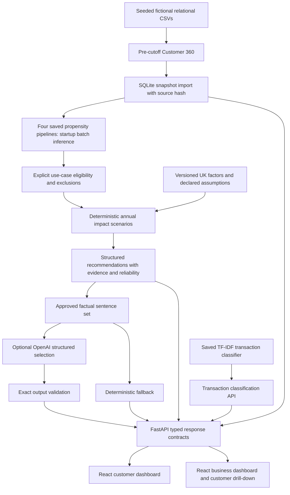

# GreenLens AI architecture

The original data/ML modules and saved models are preserved. No dataset generation or model training occurs at application startup. SQLite imports customer features, transactions and product relationships only if their source content hash changes. Restart after replacing source artifacts or models; the backend is an immutable demo snapshot per process. Models load through the existing cached loader once per process; prediction is batched over 5,000 customers with the recorded feature order. Missing-feature normalization, reason codes and product screens reuse the ML contracts.

The API separates use-case matching from credit approval. Scenario calculations operate on physical activity estimates, never on spending. The four validation-selected thresholds in `ml/reports/selected_thresholds.json` are exposed as a separate priority screen; the continuous propensity and eligibility result remain unchanged. Business ranking filters by use-case status first and then prioritizes calculable impact and supporting reasons before propensity. Carbon totals are conditional sums within each product, never summed across overlapping products.

`POST /customers/{customer_id}/scenario` accepts a short allow-list of hypothetical customer changes, reruns the saved propensity pipelines and applies the same use-case and impact rules. It does not persist changes or modify the source customer record. `GET /business/trends` returns monthly synthetic debit spend by transaction category. The business summary also reports estimated annual electricity-plus-gas demand and synthetic paperless/mobile activity separately from product propensity.

The default transaction history retains the synthetic reference labels used in the evaluated Customer 360. POST /transactions/classify runs the actual saved classifier for new descriptions; classifier errors are not silently substituted into the existing propensity training features. Production must validate that error propagation separately.

The backend offers customer pagination, customer-ID search and region filtering; transactions support pagination and category filtering. Business opportunities support product, status, region and pagination. OpenAPI is available at /docs. Route response models live in backend/schemas.py. Unknown customers return 404, invalid inputs 422, unavailable data/models 503; /health remains available with a degraded status. Database and provider credentials are server-side environment variables. Vite proxies /api to the local backend.

LLM calls send only structured recommendation facts, excluding customer ID, to the configured OpenAI model. Optional provider requests run concurrently for the four products, have bounded timeouts, and cache up to 256 customer explanation sets. Exact sentence validation fails closed. This is constrained language selection, not unrestricted narrative generation.

Local synthetic-only prototype: no authentication, application processing, payment integration or real customer access controls. Do not expose it publicly with real data. This checkout shares its Git root with the user's home directory; avoid broad staging/commits and never add `data/external/` or backup artifact directories.
